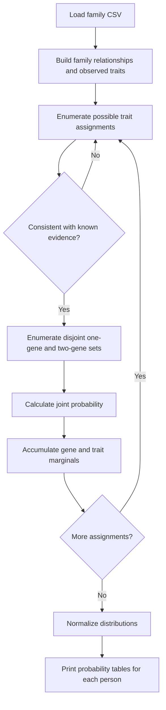

# Heredity — Probabilistic Inference in Family Genetics

**Harvard CS50's Introduction to Artificial Intelligence with Python · Project 2: Uncertainty**

   

> **Portfolio overview.** This document explains the probabilistic model, its behavior, dataset structure, and the learning outcomes of an academic assignment. It does not reproduce the assignment's solution code. The model is a simplified instructional example, not a clinical genetics tool.

## Overview

**Heredity** explores how to estimate the probability that each person in a family carries **zero, one, or two copies of a gene**, as well as the probability that they exhibit a related trait. The system combines population-level priors, parental inheritance, mutation rates, and observed trait information to infer distributions over possibilities that are not directly observed.

Unlike a deterministic family-tree lookup, the inference must consider *many possible assignments* of gene copies and traits throughout the family. It uses **exact enumeration of joint probabilities**, accumulates marginal distributions, and normalizes the results.

### Key capabilities

- Read family relationships and observed traits from CSV files.
- Represent unknown traits as missing evidence rather than assuming true or false.
- Model inheritance of gene copies from two parents, including the possibility of mutation.
- Enumerate candidate gene and trait assignments and exclude those inconsistent with observations.
- Compute joint probabilities, accumulate per-person marginals, and normalize each distribution.
- Report probabilities for `0`, `1`, or `2` gene copies and for trait presence or absence.

## Technical foundations

### 1. Probabilistic representation

For each individual, the program tracks two random variables:

| Variable | Possible outcomes | Interpretation |
|---|---|---|
| `Gene` | `0`, `1`, `2` | Number of gene copies |
| `Trait` | `True`, `False` | Whether the person exhibits the modeled trait |

The project's fixed probability table includes these **unconditional gene priors** for individuals without listed parents:

| Gene copies | Prior probability |
|---|---:|
| 2 | 0.01 |
| 1 | 0.03 |
| 0 | 0.96 |

The conditional probability of a trait depends on the number of gene copies:

| Gene copies | P(trait = True) | P(trait = False) |
|---|---:|---:|
| 2 | 0.65 | 0.35 |
| 1 | 0.56 | 0.44 |
| 0 | 0.01 | 0.99 |

The model uses a **mutation probability of 0.01**. These values are part of the educational problem specification, not estimates for any specific real-world disorder.

### 2. Parent-to-child transmission

A parent's probability of passing the gene is determined by their gene count:

| Parent gene copies | P(passing gene) |
|---|---:|
| 2 | `1 − mutation = 0.99` |
| 1 | `0.50` |
| 0 | `mutation = 0.01` |

Let `m` be the probability the mother passes a gene copy and `f` the corresponding probability for the father. Then the child's gene-copy probabilities are:

```text
P(child has 2 copies) = m × f
P(child has 1 copy)   = m × (1 − f) + (1 − m) × f
P(child has 0 copies) = (1 − m) × (1 − f)
```

The probability of a full candidate assignment is the product of each person's gene probability and their trait probability conditioned on the assigned gene count.

### 3. Exact inference and normalization

The program enumerates sets of individuals who might possess the trait, one gene copy, or two gene copies. Assignments that contradict the CSV's known trait observations are skipped. For each remaining assignment, the joint probability is added to the appropriate entries of each person's distributions.

Finally, each distribution is normalized independently:

```text
P_normalized(outcome) = accumulated_weight(outcome) / sum(all_weights)
```

This ensures that the gene-copy probabilities sum to `1` and the trait probabilities sum to `1`, subject to floating-point rounding in the printed output.

## Processing workflow



## Project files

The reviewed archive contains the following structure:

```text
heredity/
├── heredity.py            # Main command-line program and probability model
├── data/
│   ├── family0.csv         # Three-person family example
│   ├── family1.csv         # Six-person family example
│   └── family2.csv         # Five-person, multigenerational example
└── __pycache__/            # Auto-generated Python bytecode cache
```

The `__pycache__/` folder is produced automatically by Python and is not required for execution. There is no `requirements.txt` in the reviewed archive, because the implementation uses only Python's standard library (`csv`, `itertools`, and `sys`).

### Main functions

| Function | Role |
|---|---|
| `load_data(filename)` | Reads names, parental relationships, and known trait values from CSV. |
| `powerset(s)` | Enumerates subsets for possible assignments. |
| `joint_probability(...)` | Computes the likelihood of one complete hypothetical assignment. |
| `update(...)` | Adds that likelihood to individual gene/trait distributions. |
| `normalize(...)` | Normalizes distributions so they sum to one. |
| `main()` | Loads a dataset, performs exhaustive inference, and displays results. |

## Requirements and execution

**Requirements:** Python 3.12 (course-recommended). No external Python packages are required by the provided implementation.

From the project folder:

```powershell
cd "X:\IO++\GitHub Upload\heredity"
python --version
python heredity.py data/family0.csv
```

Try the other provided datasets:

```powershell
python heredity.py data/family1.csv
python heredity.py data/family2.csv
```

On macOS or Linux, run the same commands using a suitable project path and `python3` if that is how Python is installed.

### CSV input format

The input contains exactly these headings:

```csv
name,mother,father,trait
Harry,Lily,James,
James,,,1
Lily,,,0
```

- `name`: person's identifier.
- `mother` and `father`: names of parents in the same file, or blank for unspecified parents.
- `trait`: `1` for observed trait presence, `0` for observed absence, or blank for unknown.

The implementation expects parent names to match people included in the input and assumes that either both parents are specified or neither is specified.

## Verified example results

The following output was reproduced by executing the reviewed `heredity.py` with `data/family0.csv`:

```text
Harry:
  Gene:
    2: 0.0092
    1: 0.4557
    0: 0.5351
  Trait:
    True: 0.2665
    False: 0.7335
James:
  Gene:
    2: 0.1976
    1: 0.5106
    0: 0.2918
  Trait:
    True: 1.0000
    False: 0.0000
Lily:
  Gene:
    2: 0.0036
    1: 0.0136
    0: 0.9827
  Trait:
    True: 0.0000
    False: 1.0000
```

**Interpretation:** Harry's trait status is unknown, so the program calculates a nontrivial probability of exhibiting the trait. James's observed trait is present and Lily's is absent, so their trait probabilities remain fixed at `1` or `0` accordingly. The gene-copy distributions remain probabilistic even when a trait value is known.

The reviewed program also ran successfully on `family1.csv` and `family2.csv`. The example above is not a medical prediction; it illustrates inference under a specified probabilistic model.

## Complexity and limitations

- The method performs **exhaustive enumeration**. The number of candidate assignments grows exponentially with family size, so this approach suits small educational datasets rather than large pedigrees.
- Exact inference avoids random sampling error for the specified model but depends entirely on its assumptions and fixed probability parameters.
- The model describes one simplified gene/trait relationship and does not model the full complexity of real genetic inheritance.
- Recorded trait observations are treated as reliable inputs.

## Skills demonstrated

**Artificial Intelligence · Probabilistic Reasoning · Bayesian Inference · Joint Probability · Conditional Probability · Exact Enumeration · Marginalization · Python · CSV Data Processing · Algorithmic Modeling**

## Academic context and attribution

This project was completed as part of **Harvard University's CS50's Introduction to Artificial Intelligence with Python**. Course assignment and supplied educational materials are credited to the CS50 team.

- [Official Heredity assignment](https://cs50.harvard.edu/ai/projects/2/heredity/)
- [CS50's Introduction to Artificial Intelligence with Python](https://cs50.harvard.edu/ai/)
- [Verified CS50AI certificate](https://cs50.harvard.edu/certificates/4d1848b5-b7cc-4b37-8155-819e19e6054d)
- [CS50 academic honesty policy](https://cs50.harvard.edu/ai/honesty/)

**Academic integrity note:** The public-facing README documents the concepts and observed behavior without providing a copy of the course's evaluated source-code solution. Keep original assessment solutions private unless publication is expressly permitted by CS50.
